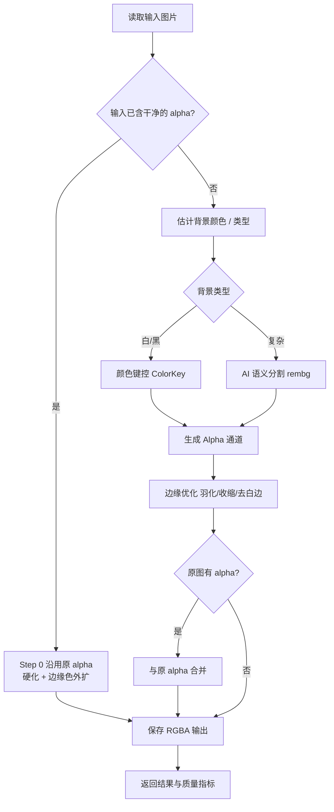
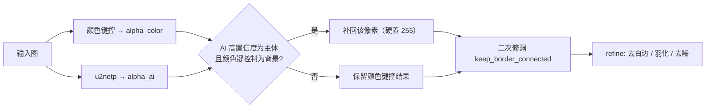

# 图片背景去除工具（LucentCut）技术方案设计

> 版本：**v1.6**
> 日期：2026-10-11
> 项目代号：lucency_widget
> 文档状态：M1–M13 全部实现，端到端自测 149 项全通过，可交付验收
>
> 版本变更说明
> - v0.1：初稿，需求分析与算法设计
> - v0.2：补充 AI 语义分割详解、本地 vs 云端结论、交互式抠图方案、PySide6 决策
> - v0.3：追加 M1 实测结果、两则误删案例的量化根因分析、算法能力边界、
>   已实施的修复（沿用已有 alpha、alpha 硬化、小图自适应羽化、CLI 入口），更新里程碑与决策记录
> - v0.4：新增第 0 章「开发约定」（三文档联动规则），配套新增《修改文档.md》《使用功能说明.md》
> - v1.0：M2 桌面 GUI、M5 AI 语义分割、M7 交互式抠图（四种）、M3 打包全部完成；
>   新增「任意纯色背景」支持（solid 模式），扩展引擎参数；补全端到端自测（18 项全通过）
> - v1.1：新增 **M8 混合引擎**（颜色轮廓 + AI 补齐，设为默认），修复
>   "白底上的白色衣服被整块抠掉"；AI 推理改为**自包含实现**（去掉 rembg/scipy 整条依赖链），
>   修复打包后 exe 报"AI 不可用"；补 EXIF 转正、GUI 沿用已有 alpha、羽化参数三个隐性缺陷；
>   自测由 18 项扩充到 56 项（含 17 项边界/异常用例）
> - v1.2：新增 **M9 交互增强与人工裁决层**——中键拖动平移 / 适应窗口、
>   一次描多个区域、三级撤销、**框内保留 / 框内去除**（裁决层独立于算法、永远最后叠加、
>   优先于算法、按原图 RGB 回填）；新增参数「手动区边缘柔化」；
>   自测由 56 项扩充到 92 项（新增裁决层 15 项、画布交互 11 项、GUI 流程 8 项）
> - v1.3：新增 **M10 交互语义修正**——
>   ① 处理完成后不再残留绿/红覆盖层，改由「显示修改区」开关控制（默认关闭）；
>   ② **点选改为直接涂抹笔刷**（不再走 GrabCut 种子点），左键涂保留、右键涂去除、
>      按住可连续涂，笔刷半径可调；
>   ③ 「作用」下拉只保留 保留/去除 两个确定语义，GrabCut 抽成独立按钮且须先画区域，
>      修复"应用选区后整图变红（被当成背景删光）"的误用；
>   自测由 92 项扩充到 111 项（新增笔刷/显示开关/提交语义 19 项）
> - v1.4：新增 **M11 画质修复**（浅色内部部件残留半透明 / 眼睛高光发灰）——
>   ① `keep_border_connected` 修洞阈值由 128 提到 **250**，修复主体内部 [128,254] 的
>      "孤儿像素"被永久留成半透明；② `rescue_subject` 不再逐像素写 AI 软 alpha，
>      改为**整块 restore 置 255** 并在末尾**二次修洞**，修复 AI 补齐区内部残留半透明；
>   自测由 111 项扩充到 121 项（新增 [11] 画质回归 10 项）
> - **v1.5（本版）**：新增 **M12 精细抠图引擎 `matting`**（BiRefNet / ISNet 大模型，1024×1024）——
>   ① 新增自包含模块 `core/hq_segment.py`，仅依赖 onnxruntime，模型可缺省、自动回退；
>   ② 复杂背景走大模型（头发丝/飘带/细长道具不再糊成"圆头团块"），纯色背景自动落回
>      颜色键控；③ 引擎下拉首项设为"精细抠图（matting）"并成为 GUI/CLI 默认；
>      ④ 修复 onnxruntime 在 1024×1024 连跑第二张图 "bad allocation" 的内存池不回收坑；
>      ⑤ 新增 `tools/download_models.py`（断点续传）与 `tools/make_comparison.py`（对比图）；
>   自测由 121 项扩充到 134 项（新增 [13] 精细抠图引擎 13 项，与参考图 IoU 0.988）。
>   打包体积由 ~45MB 增至 ~442MB（内含 224MB BiRefNet + 178MB ISNet 模型）。
> - **v1.6（本版）**：新增 **M13 裁决语义修正 + 进度显示**——
>   ① 裁决层跨笔合并改"**后画的覆盖先画的**"（`merge_override_masks`），修复
>      "先保留过的区域，后画去除不生效"；② 点选改"**颜色即语义**"（绿=保留/
>      红=去除，提交时不再按「作用」下拉反推），修复"点选去除被当成保留"；
>   ③ 「开始处理」自动并入画布上未提交的涂抹（`canvas.take_selection()`），
>      修复"画了没生效+圆点残留"；④ 左下角**进度条**（单张忙指示 / 批量精确
>      到张）+ **处理耗时**显示；⑤ `_process` 防重入，处理中提交的选区完成后
>      自动重叠加；自测由 134 项扩充到 149 项（新增 [14] 裁决语义与进度 15 项）。

---

## 0. 开发约定（强制）

> 以下三条为本项目**强制执行的协作规则**，任何一次代码改动都必须遵守。
> 违反会造成文档与代码脱节，导致后续维护无法追溯改动原因。

### 文档体系（三件套）

| 文档 | 面向对象 | 职责 |
| --- | --- | --- |
| `docs/技术方案设计.md`（本文档） | 开发 / 评审 | 需求、架构、算法设计、模块接口、里程碑、已知限制 |
| `docs/修改文档.md` | 开发 / 追溯 | **流水日志**：每条 = 时间戳 + 标题 + 现象/根因/修复/验证/经验 |
| `docs/使用功能说明.md` | 终端用户 | 能做什么、怎么用、参数怎么调、已知限制与 FAQ |

> 规则中所称《技术方案》即指本文档 `docs/技术方案设计.md`。

### 规则 1｜改代码必须同步更新《修改文档.md》

每次修改代码时，**必须**完成 `docs/修改文档.md` 的更新，格式沿用该文档既有条目，
每一条记录包含五个要素：

```
1. 时间    ：改动发生的日期（YYYY-MM-DD）
2. 问题/任务：现象描述，或此次要完成的任务
3. 根因    ：为什么会出问题 / 为什么要改（含量化依据更好）
4. 解决方案：改了什么，为什么这样改
5. 代码片段：改动前后的关键代码对照
```

### 规则 2｜新增功能必须同步更新两份文档

每新增一个功能后，**必须**同步更新：

| 文档 | 更新内容 |
| --- | --- |
| `docs/使用功能说明.md` | 面向用户：新增了什么能力、怎么用、参数如何调 |
| `docs/技术方案设计.md`（本文档） | 面向开发：需求表、算法设计、模块接口、里程碑、已知限制 |

二者缺一不可——只有使用说明会丢设计依据，只有技术方案会让用户无法上手。

### 规则 3｜交付时在**对话中**向用户展示本次改动

每次输出（交付修改）时，**必须在本对话框的回复里**把改动展示出来，让用户能直接定位复查。

> ⚠️ 注意：这一条是对**助手回复行为**的要求，**不需要写进《修改文档.md》**。
> 《修改文档.md》记录的是"为什么改"，本规则要求的是"回复里要告诉用户改了哪儿"。

执行方式：

- **改动少**：直接把修改前后的代码片段**打印在回复中**；
- **改动多**：至少列明「修改了哪些函数 / 规则，分别在哪个文件的哪个位置」，格式建议：

```
文件: src/core/pipeline.py
  函数 process_image()  行 84-131  新增 Step 0 分支 —— 命中已抠好 alpha 时直接沿用
文件: src/core/io.py
  新增函数 alpha_is_trimmed()  行 63-121  已有透明通道检测
```

---

## 目录

0. [开发约定（强制）](#0-开发约定强制)
1. [项目概述](#1-项目概述)
2. [需求分析](#2-需求分析)
3. [测试样本分析](#3-测试样本分析)
4. [总体架构设计](#4-总体架构设计)
5. [核心算法设计](#5-核心算法设计)
   - [5.1 阶段一：纯色背景去除](#51-阶段一纯色背景去除白底--黑底)
   - [5.2 阶段二：AI 语义分割（通用主体提取）](#52-阶段二ai-语义分割通用主体提取)
   - [5.3 边缘处理与后处理](#53-边缘处理与后处理三阶段共用)
   - [5.4 阶段三：交互式抠图](#54-阶段三交互式抠图手动兜底)
   - [5.5 算法能力边界与失效场景](#55-算法能力边界与失效场景)
6. [界面与交互设计](#6-界面与交互设计)
7. [数据流与模块接口](#7-数据流与模块接口)
8. [测试方案](#8-测试方案)
9. [依赖与技术栈](#9-依赖与技术栈)
10. [里程碑与迭代计划](#10-里程碑与迭代计划)
11. [风险与待确认问题](#11-风险与待确认问题)
12. [M1 实现结果与问题诊断](#12-m1-实现结果与问题诊断)
13. [附录](#13-附录)

---

## 1. 项目概述

### 1.1 背景

日常设计、电商、PPT 制作场景中，经常需要把一张带背景的图片处理成**透明背景（Alpha 通道）的 PNG**，以便自由叠加到其他背景上。Photoshop 等专业工具门槛高、收费，批量处理效率低。本项目旨在做一个**轻量、可配置路径、可批量处理**的本地小工具。

### 1.2 项目目标

- **一期目标**：去除**纯白（近白）与纯黑**背景，输出透明背景 PNG。✅ 已达成
- **二期目标**：去除**任意背景**（渐变、纹理、自然场景），语义提取前景主体。
- **三期目标**：提供**手动辅助**（框选/点选/描边/套索），在自动结果不理想时人工兜底。
- **通用目标**：输入输出路径可自定义；支持单张与批量；保留原图分辨率；无明显白边。

### 1.3 非目标

- 不做图像编辑（裁剪、调色、滤镜）。
- 不做在线服务 / 云端上传（纯本地处理，保护隐私）。
- 不做视频抠图。

### 1.4 术语定义

| 术语 | 含义 |
| --- | --- |
| Alpha 通道 | 图片的透明度通道，0=完全透明，255=完全不透明 |
| 抠图 / Matting | 计算每个像素的前景透明度，得到 Alpha 通道 |
| 色度键控 / Chroma Key | 基于背景颜色差异抠图（绿幕、白底、黑底均属此类） |
| 语义分割 | 用神经网络判断每个像素属于什么"物体类别"，从而分离主体 |
| Trimap | 把图像分为确定前景、确定背景、未知区域三部分，用于精细抠图 |
| 概率图 / Soft Mask | 模型输出的 0~1 前景概率，每个像素一个值 |

---

## 2. 需求分析

### 2.1 功能需求

| 编号 | 需求 | 优先级 | 阶段 | 状态 |
| --- | --- | --- | --- | --- |
| F1 | 支持设置**输入图片路径**（单文件） | P0 | 一期 | ✅ CLI 已支持 |
| F2 | 支持设置**输出路径**（含文件名） | P0 | 一期 | ✅ CLI 已支持 |
| F3 | 去除纯白/近白背景，输出透明 PNG | P0 | 一期 | ✅ |
| F4 | 去除纯黑背景 | P0 | 一期 | ✅ |
| F5 | 支持**批量处理**一个文件夹 | P1 | 一期 | ✅ CLI 已支持 |
| F6 | 自动识别背景类型（白/黑/复杂） | P1 | 一期 | ✅（复杂背景→报错，转二期） |
| F7 | **输入已含透明通道时直接沿用**，不重复抠图 | P1 | 一期 | ✅ v0.3 新增 |
| F8 | 去除任意复杂背景，语义提取前景主体 | P0 | 二期 | ⬜ |
| F9 | 交互式抠图：矩形框选 / 点选 / 描边 / 套索 | P1 | 三期 | ⬜ |
| F10 | 支持调节抠图灵敏度、羽化、去白边参数 | P2 | 一期 | ✅ CLI 已支持 |
| F11 | Windows 桌面 GUI 窗口 | P0 | 二期(M2) | ⬜ |

### 2.2 非功能需求

| 类别 | 要求 |
| --- | --- |
| 平台 | Windows 优先，代码保持跨平台 |
| 性能 | 单张 1024×1024 < 2s（纯色模式）；AI 模式 < 8s |
| 依赖 | 纯色模式零 AI 依赖；AI 能力可选安装 |
| 隐私 | 全本地处理，不联网上传图片 |
| 可维护 | 算法与界面解耦，核心逻辑可独立测试 |
| 容错 | 路径不存在、格式不支持、图片损坏时给出明确提示 |

---

## 3. 测试样本分析

对 `image/` 目录下 8 张样本的实际像素分析结果：

| 图片 | 尺寸 | 格式 | 背景特征 | 近白占比 | 自带 alpha | 分类 | 处理策略 |
| --- | --- | --- | --- | --- | --- | --- | --- |
| deekseep3.jpg | 1080×1349 | JPEG | 近白 (253,253,253) | 72.1% | 否 | 白底 | 颜色阈值 |
| deepseek.jpg | 1024×1024 | JPEG | 近白，右下角被主体占据 | 38.5% | 否 | 白底 | 颜色阈值 |
| deepseek1.jpg | 1024×1024 | JPEG | 近白，右下角蓝色主体 | 37.9% | 否 | 白底 | 颜色阈值 |
| deepseek2.png | 180×190 | PNG | 纯白 (255,255,255) | 34.7% | 否 | 白底 | 颜色阈值 |
| system.png | 30×35 | PNG | 纯白小图标 | 78.8% | 否 | 白底 | 颜色阈值 |
| deepseek4.png | 1234×1275 | PNG(RGBA) | 纯黑，**已抠好** | 5.0% | **是** | 已抠图 | **直接沿用 alpha** |
| 黑色背景.jpg | 425×425 | JPEG | 纯黑 (1,1,1) | 9.6% | 否 | 黑底 | 颜色阈值（黑） |
| 其他背景.jpg | 1036×1288 | JPEG | 米色纹理渐变 | 0.54% | 否 | **复杂背景** | **AI 分割** |

### 关键结论

1. **样本覆盖三大类**：纯白底、纯黑底、复杂背景，验证三阶段方案合理性。
2. **JPEG 白底不是纯 255**，而是 252–254，阈值必须留余量。
3. **主体可能接触边角**：`deepseek.jpg` 右下角被主体占据，因此背景色不能只取四角，必须用边框采样 + 连通域判断。
4. **存在"已抠好"的输入**：`deepseek4.png` 自带干净 alpha（二值占比 99.5%、边框透明率 100%），
   若不加判断地按颜色重抠会造成误删 —— 详见 [12.2](#122-case-a--deepseek4png-已有-alpha-却被重复抠图可修复)。
5. **尺寸跨度大**：30×35 到 1234×1275，需按图幅自适应参数（v0.3 已实现羽化自适应）。

---

## 4. 总体架构设计

### 4.1 分层架构

```
┌─────────────────────────────────────────────┐
│  界面层 (UI Layer)                            │
│  ├── CLI 命令行入口  src/main.py     ✅ M1    │
│  └── GUI 桌面窗口 PySide6            ⬜ M2    │
├─────────────────────────────────────────────┤
│  业务层 (Service Layer)                        │
│  ├── 任务编排 Pipeline               ✅ M1    │
│  ├── 批处理调度 BatchRunner          ✅ M1    │
│  └── 配置管理 ConfigManager          ⬜ M2    │
├─────────────────────────────────────────────┤
│  算法层 (Algorithm Layer)  ★核心               │
│  ├── alpha_is_trimmed 已有透明通道检测 ✅ M1   │
│  ├── detect_mode     背景类型识别     ✅ M1    │
│  ├── colorkey        纯色抠图         ✅ M1    │
│  ├── refine          边缘优化         ✅ M1    │
│  ├── segmentation    AI 分割          ⬜ M5    │
│  └── interactive     交互式抠图       ⬜ M7    │
├─────────────────────────────────────────────┤
│  基础层 (Infra Layer)                          │
│  ├── io      图像读写 Pillow          ✅      │
│  ├── numpy   数值计算                 ✅      │
│  └── opencv  形态学 / 连通域          ✅      │
└─────────────────────────────────────────────┘
```

### 4.2 处理主流程



> **说明**：`A2` 分支是 v0.3 新增，源于 M1 实测发现的真实缺陷（见 [12.2](#122-case-a--deepseek4png-已有-alpha-却被重复抠图可修复)）。

---

## 5. 核心算法设计

### 5.1 阶段一：纯色背景去除（白底 / 黑底）

**思路**：背景色已知（白或黑），对每个像素计算其与背景色的差异，差异小 → 透明，差异大 → 保留。用**软阈值 + 羽化**得到平滑边缘。

#### Step 0｜已有透明通道检测（v0.3 新增：决定"要不要抠"）

已经抠好的 PNG，其透明区域下方的 RGB 通常被压成**纯黑**（图像保存机制所致）。若不加判断地按颜色再抠一遍，会造成两个后果：

1. 算法看到边框发黑 → 误判为"黑底图"；
2. 主体上接近黑色的部分（深色衣饰、头发暗部）被当成背景删掉。

因此先用轻量检测判断输入是否已是"抠好的透明图"，**两个条件同时满足才算已抠好**：

```
① 二值性     : alpha < 32 或 > 224 的像素占比 ≥ 98%
                （抠好的图几乎非 0 即 255，没有大量半透明中间层）
② 边框透明率 : 四条边框 alpha < 16 的占比 ≥ 90%
                （说明背景确实被掏空，而非只抠了局部）
```

满足则**直接沿用原 alpha**，完全跳过颜色键控，只做 alpha 硬化与边缘色外扩。

**实测收益**（`deepseek4.png`）：误删主体像素 **25354 → 0**。

#### Step 1｜背景色估计

不直接取四角（防止主体占角），而是：

- 对四条边框像素采样；
- 用**逐通道中位数**估计背景代表色 `bg = (r, g, b)`；
- 再用"边框像素中接近该代表色的**内点占比**"判断是否纯色背景。

> ⚠️ **踩过的坑**：最初用"边框颜色标准差 σ"判断是否纯色，结果 `deepseek.jpg` 右下角的主体把 σ 拉高，
> **6 张白底图全被误判成复杂背景而跳过**。改用"内点占比"后全部识别正确。
> 原因：主体占角只是少数派，中位数抗得住；但少数派足以炸掉标准差。

#### Step 2｜计算色差

RGB 空间欧氏距离：

```
dist(p) = √[(pr−bgr)² + (pg−bgg)² + (pb−bgb)²]
```

> 优化方向：改用感知更均匀的 Lab 空间或加权欧氏距离。
> 注意：对**黑底**，低饱和深色主体易与背景混淆，需结合亮度 + 饱和度双重判断。

#### Step 3｜软阈值生成 Alpha

```
dist ≤ t_low               →  alpha = 0                                 （确定背景）
t_low < dist < t_high      →  alpha = 255·(dist − t_low)/(t_high − t_low) （过渡带）
dist ≥ t_high              →  alpha = 255                               （确定前景）
```

默认 `t_low=30`、`t_high=80`。过渡带让锐利边界自然羽化，避免锯齿。

#### Step 4｜连通域修正（防误抠出洞）

**问题**：主体内部的白色区域（白色文字、白色衣饰、反光）会被 Step 3 判为背景。

**方案**：对 `alpha < 128` 的区域做连通域分析，**仅保留与图像边界连通的透明区为真背景**，
不与边界连通的独立块恢复为不透明。

> ⚠️ **重要限定**（v0.3 补充）：这条规则**只能救"被完全包围的内部区域"**。
> 若主体的白色部件**在画面边缘被裁断**、与外部背景像素直接连通，连通域分析就救不回来
> —— 因为它们在拓扑上确实是同一个区域。详见 [12.3](#123-case-b--deepseek2png-白色衣领颜色方法的原理天花板)。

#### Step 5｜去白边（Despill）

背景为白色时，主体边缘常残留浅白"光晕"。用合成公式反解前景色：

```
C = α·F + (1−α)·B    ⟹    F = (C − (1−α)·B) / α
```

只对半透明边缘像素处理，并给 α 设下限（默认 0.2）避免数值爆炸。

**实测有效**：`deekseep3.jpg` 边缘像素"白度"（三通道最小值均值）**212 → 169**。

#### 参数表

| 参数 | 默认值 | 说明 |
| --- | --- | --- |
| `mode` | auto | white / black / auto |
| `t_low` | 30 | 低于此色差 → 全透明 |
| `t_high` | 80 | 高于此色差 → 全保留 |
| `feather` | 自适应 | `min(H,W) ≤ 64` 时为 0（小图标不羽化），否则 1 |
| `despill` | on | 是否去白边 |
| `fix_holes` | on | 是否做连通域修正 |
| `reuse_existing_alpha` | on | 是否沿用输入自带的干净 alpha |

---

### 5.2 阶段二：AI 语义分割（通用主体提取）

#### 5.2.1 什么是 AI 语义分割

**与传统方法的本质区别**：

| | 传统颜色键控（一期） | AI 语义分割（二期） |
| --- | --- | --- |
| 判断依据 | **像素颜色**："接近白色的删掉" | **内容理解**："这是什么物体，哪部分是主体" |
| 处理 `其他背景.jpg`（米色纹理） | ❌ 无单一背景色可比 | ✅ 模型知道"这是商品/人物" |
| 区分"白衣服 vs 白背景" | ❌ 两者颜色完全相同 | ✅ 靠轮廓与语义上下文 |
| 是否联网 | 否 | 否（用本地模型） |

**实现原理**：

```
输入图片
  → 编码器：逐层下采样，压缩成语义特征（回答"这是什么"）
  → 解码器：逐层上采样，还原到原图尺寸
  → 概率图：每个像素输出 0~1 的"属于前景"概率
  → 阈值化 → Alpha 通道 → 透明 PNG
```

典型结构为 U-Net 系列（U²-Net、ISNet）的"编码器-解码器 + 跳跃连接"。

**关于训练**：训练由做模型的机构完成（用成千上万对"原图 + 人工标注 mask"），
我们**只使用训练好的模型**（预训练权重，一个 50–300MB 的 `.onnx` 文件），**不需要也不必自己训练**。

#### 5.2.2 是否需要连接云端 AI 的 API

**结论：不需要，也不建议。使用本地离线模型。**

| | 本地模型推理（推荐） | 云端 API |
| --- | --- | --- |
| 代表 | rembg（U²-Net / ISNet）、BiRefNet | remove.bg、腾讯云/阿里云图像分割、多模态大模型 |
| 联网 | **不需要，完全离线** | 必须联网 |
| 费用 | 免费 | 按次计费 |
| 隐私 | **图片不出本机** | 需上传到他人服务器 |
| 速度 | 首次加载模型慢，之后每张 1~5s（CPU） | 取决于网速与配额 |
| 部署 | 需下载模型文件 | 拿到 key 即可用 |

**决策**：二期主流程走本地模型，无需 API key。
云端 API 仅作为"本机无算力 / 追求极致质量"场景下的**可选插件**，不进主流程。

#### 5.2.2.1 推理方式：自包含实现（v1.1 起采用）

> **变更**：M5 最初通过第三方库 `rembg` 调用 u2netp。v1.1 改为**自包含推理**——
> 直接用 `onnxruntime` 加载本地 `.onnx` 文件，前后处理自己实现。

**为什么要改**：M5 交付后实测，打包出的 exe 选 AI 引擎会弹"AI 分割依赖未安装"。
根因是依赖链的**顶层 import** 远比想象中重：

```
rembg/__init__.py ──> from .bg import remove
rembg/bg.py       ──> import pymatting / scipy.ndimage / skimage.morphology
                      （在模块顶层，导入即执行，与是否调用 alpha_matting 无关）
```

而 `build.spec` 里排除了 `scipy`，于是冻结环境下 `import rembg` 直接失败。
换句话说：为了只用 u2netp 这一条推理链，却必须打包 scipy + skimage + pymatting 全家。

**自包含实现做了什么**：复刻 `rembg/sessions/u2netp.py` 与 `sessions/base.py` 的计算过程。

| 步骤 | 实现 |
| --- | --- |
| 预处理 | RGB → LANCZOS 缩放到 320×320 → `/255` → 逐通道 `(x-mean)/std`（mean/std 与训练一致）→ HWC 转 CHW → 加 batch 维 |
| 推理 | `ort.InferenceSession(path, providers=["CPUExecutionProvider"]).run(...)` |
| 后处理 | 取 `out[0][:,0,:,:]` → min-max 归一化到 [0,1] → `×255` → LANCZOS 放大回原尺寸 |

**等价性保证**：测试用例「与 rembg 输出逐像素一致」会对照组比输出，要求 `max diff == 0`。
实现时注意过一处精度坑：中间归一化的算术必须用 `float64`（与 numpy 默认精度一致），
若全程 `float32`，会有零星像素与 rembg 差 1 个灰阶。

**改完之后**：

| | 通过 rembg | 自包含实现 |
| --- | --- | --- |
| 必需依赖 | rembg、pooch、pymatting、scipy、scikit-image、onnxruntime | onnxruntime、numpy、Pillow |
| 可用性检测 | `import rembg` 成败 | `import onnxruntime` 成功 + 模型文件存在与否 |
| 模型路径 | 需推导 `U2NET_HOME` 层级，写错一级就去联网下载 | 直接按候选目录搜模型文件，命中即用，不联网 |
| 错误提示 | 笼统的"依赖未安装" | `availability_detail()` 给出具体原因 |
| exe 体积 | 184MB | **134MB** |

#### 5.2.3 模型选型

| 方案 | 原理 | 优点 | 缺点 | 定位 |
| --- | --- | --- | --- | --- |
| **rembg (U²-Net / ISNet)** | 深度显著性分割 | 开箱即用、通用物体、可离线 | 依赖 onnxruntime，边缘略糙 | **二期首选** |
| **BiRefNet** | 高分辨率双参考分割 | SOTA 精度、接近发丝级 | 模型较大、最好有 GPU | 二期增强 |
| **MODNet** | 人像专用 | 人像效果好 | 仅人像 | 人像场景 |
| **SAM / SAM2** | 提示式分割 | 极强通用性 | 需人工提示、模型大 | 交互式抠图 |
| **RMBG-2.0** | 专用抠图模型 | 质量高 | 商用授权需确认 | 备选 |

**推荐路线**：二期先上 `rembg`（U²-Net/ISNet）做**通用物体**；精度不足再升级 BiRefNet 或叠加 matting 精修。

#### 5.2.4 精细流程（可选，M6）


---

### 5.3 边缘处理与后处理（三阶段共用）

| 处理 | 目的 | 方法 | 状态 |
| --- | --- | --- | --- |
| 羽化 Feather | 消除硬锯齿 | alpha 高斯模糊（半径按尺寸自适应） | ✅ |
| 收缩 Erode | 去掉背景残留光晕 | 形态学腐蚀 alpha | ✅ |
| 去污染 Despill | 去白边 / 黑边 | 合成公式反解前景色 | ✅ |
| 去噪 Denoise | 去孤立噪点 | 连通域面积过滤 | ✅ |
| alpha 硬化 Harden | 254→255、1→0 | 两端吸附，保留中间过渡带 | ✅ v0.3 |
| 边缘色外扩 Extend | 防止透明区黑边 | 边缘颜色向透明区逐轮扩散 | ✅ v0.3 |
| Matting 精修 | 发丝级边缘 | trimap + alpha matting | ⬜ M6 |

> **alpha 硬化的由来**：实测 `deepseek4.png` 主体 alpha 大面积是 **254 而非 255**（占 58.5%，纯 255 仅 0.10%）。
> 这在部分软件里会被当作半透明处理，因此沿用模式下默认硬化，且只吸附两端、保留真实过渡像素。

---

### 5.4 阶段三：交互式抠图（手动兜底）

当自动算法失败（见 [5.5](#55-算法能力边界与失效场景)），让用户用鼠标指定主体区域。**四种方式都计划实现，用于横向对比效果。**

| 方式 | 交互 | 算法 | 优点 | 缺点 |
| --- | --- | --- | --- | --- |
| **矩形框选** | 拖拽矩形框住主体 | OpenCV **GrabCut** 迭代分离前后景 | 无需 AI 模型、秒级、依赖轻 | 主体与背景颜色接近时效果一般 |
| **点选 / 涂抹笔刷**（v1.3 改造） | 按住左键涂抹 = 保留，右键涂抹 = 去除 | **直接写 keep/drop 裁决层**（圆盘掩码），不走 GrabCut | 所见即所得、可精修小面积（眼白、高光） | 大面积涂抹效率低，需配描边/套索 |
| **描边（多边形）** | 沿轮廓依次点击成多边形 | 多边形填充 → mask → 羽化 | 形状不规则时最可控 | 用户操作量大 |
| **套索（自由曲线）** | 按住鼠标沿轮廓自由绘制 | 轨迹闭合成 mask → 羽化 | 最符合直觉、贴合任意形状 | 手抖影响边界质量 |

**统一后处理**：四种方式得到粗 mask 后，统一走"边缘羽化 →（可选）GrabCut/Matting 精修 → 去噪"流水线。

**产品定位**：交互抠图是**兜底工具而非主流程**。如果每张图都要手动圈，批量场景就失去意义。
设计上作为"自动跑完后，哪里漏了补哪里"的一键补救手段。

```
┌─ 交互模式界面 ──────────────────────────────┐
│ 工具: [矩形框选] [点选] [描边] [套索] [橡皮]  │
│                                             │
│  ┌───────────────────────────────────────┐  │
│  │              图片画布                  │  │
│  │     蓝色 = 保留笔刷   红色 = 去除笔刷   │  │
│  └───────────────────────────────────────┘  │
│  [撤销] [重做] [清除]      [应用 → 提取主体] │
└─────────────────────────────────────────────┘
```

---

### 5.5 算法能力边界与失效场景

> 本节为 v0.3 新增，结论均来自 M1 实测的量化数据。**这张表决定了二、三期为什么是必需的。**

| 场景 | 颜色键控能否处理 | 原因 | 解决方案 |
| --- | --- | --- | --- |
| 背景为纯白/纯黑/近纯色 | ✅ 能 | 颜色差异明确 | — |
| 主体**内部**的背景色区域（被完全包围） | ✅ 能 | 连通域修正可识别"不与边界连通" | Step 4 已实现 |
| **手臂与身体之间的空隙**、圆环镂空 | ⚠️ 易误保留 | "是否在内部"不是正确判据 | AI 语义 / 人工指定 |
| 主体**白色部件在画面边缘被裁断** | ❌ **不能** | 与外部白背景颜色相同且像素连通 | **AI 语义分割（二期）** |
| 复杂纹理 / 渐变 / 自然背景 | ❌ 不能 | 无单一背景色可比 | **AI 语义分割（二期）** |
| 输入已是抠好的透明 PNG | ⚠️ 原会误删 | 透明区 RGB 偏黑误判为黑底 | **Step 0 检测沿用（已修复）** |
| 发丝、半透明物体 | ❌ 不能 | 需亚像素级 alpha 估计 | trimap + matting（M6） |

**核心结论**：判断"某一块该不该删"，单靠颜色**在原理上存在天花板**。
真正可靠的依据是 ① **语义理解**（知道那是什么）、② **轮廓/描边线索**、③ **用户意图**。
因此二期 AI 与三期交互抠图不是锦上添花，而是补齐能力缺口的必需品。

---

### 5.6 混合引擎 hybrid（M8，v1.1 新增，已设为默认）

> 起因：用户验收时发现 `image/动漫表情包图` 里前几张图把角色的白色衣服/头饰整块抠没了。

#### 5.6.1 两个引擎的失败模式互补

| 引擎 | 优点 | 失效场景 | 例子 |
| --- | --- | --- | --- |
| 颜色键控 | 轮廓锐利、贴合原图边缘、无需模型 | 背景与主体同色且像素连通时被一并删掉 | `doro1.png` 三个 Q 版人物的白裙整体被抠穿（保留率从 49% 掉到 46%） |
| AI 语义分割 | "看懂"主体，能识别白色衣物 | 可能漏分割；边缘糊、有 halo | `0EC8...jpg` u2netp 只认出脸和下巴，身体整被切掉 |

白底上的白裙子为什么必然被删？不是 bug 而是原理问题：裙子的白与背景白**色差≈0**，
中间又没有深色描边隔开，`keep_border_connected` 的洪泛会从图像边框一路灌进裙子里，
把它判成"与边界连通的背景"。调阈值救不回来——唯一的区分信息是"语义"，不是"颜色"。

#### 5.6.2 融合策略：谁弱听谁



对应实现（`core/ai_segment.py::rescue_subject`，v1.4 已修正）：

```python
subj    = _keep_large_components(ai_alpha >= hi, min_area_ratio)  # 去掉 AI 零星误报
restore = subj & (color_alpha < lo)                               # 只补"AI 说是主体、颜色说不是"的像素
out     = color_alpha.copy()
out[restore] = 255                                                # v1.4: 整块硬置 255（不再写 AI 软值）
out = colorkey.keep_border_connected(out)                         # v1.4: 二次修洞，消除填实后新围出的内部洞
```

设计取舍（v1.4 修正第 2 条）：

1. **AI 判背景的地方一律不动**。这是"比任一引擎都不差"的关键：AI 漏分割时（如 0EC8），
   `restore` 为空集，结果退化为纯颜色键控，不会被 AI 带偏。
2. `restore` 区块**硬置 255** 而非写 AI 软 alpha（v1.4 修正）。AI 的 alpha 是**置信度**而非
   真实透明度，写成软值会在主体内部留下 170~249 的半透明脏斑（就是用户看到的"眼睛高光发灰"）。
   边缘抗锯齿交给 restore 外侧的 AI 软 fringe 与 refine.feather。
3. 先按连通域去掉面积 < 0.15% 的块，否则 AI 在背景上的零星误报会被补成脏点。
4. 填实 `subj` 后**必须再跑一次 `keep_border_connected`**：AI 主体比颜色前景大，填实会把
   原本连通边框的背景围成内部洞（这些洞同样落在 [128,254]，成为新的半透明斑）。

#### 5.6.3 实测结果（`image/动漫表情包图` 17 张）

| 样本 | 补齐率 | 效果 |
| --- | --- | --- |
| `E3F8...jpg`（60×60 白猫） | 13.7% | 白脸白身从几乎全透明 → 完整呈现 |
| `8F9E...jpg`（红发少女白衣） | 3.1% | 白色/粉色衣服恢复 |
| `doro1.png`（三个白裙 Q 版） | 2.8% | 三条裙子全部补回 |
| `deepseek2.png`（白衬衫领） | 0.6% | 领口补回 |
| `deepseek.jpg / deepseek1.jpg`（女仆头饰） | 0.9% / 1.1% | 白色头纱恢复 |
| `0EC8...jpg`（AI 漏分割样本） | **0.00%** | 不被 AI 带偏（验证第 1 条取舍） |

#### 5.6.4 引擎选择建议

| 场景 | 推荐引擎 |
| --- | --- |
| 复杂背景、实景照片、头发丝/飘带/细长道具 | **matting（v1.5 起为默认）** |
| 干净白底/黑底、想最快速度 | color（或任选引擎，会自动落回颜色键控） |
| 想完全绕开大模型、轻量跑 | hybrid |
| 只想看语义分割、不要颜色键控参与 | ai |

> v1.5 起 GUI/CLI 默认引擎改为 `matting`。它在**复杂背景**时调度 BiRefNet 大模型，
> **纯色背景**时自动落回下方 hybrid 的颜色键控路径（等于 hybrid 的超集行为），
> 模型文件缺失时再退回 u2netp —— 三种情况都不报错，只是画质/耗时不同。

### 5.7 人工裁决层（M9，v1.2 新增）

> 起因：用户提出"能不能加一个框内保留 / 框内去除，方便去除效果不好时自己改"，
> 并追问关键问题：**"如果先按默认算法处理，然后再描边，再运行一次，那么还会保留吗？
> 这个保留是按原图还是按处理后的图片？"**

#### 5.7.1 决策：裁决层是独立于算法的"最终一层"

| 编号 | 决策 | 理由 |
| --- | --- | --- |
| **D9** | 用户描出的保留/去除区域保存为**独立的裁决层**（`keep_mask` / `drop_mask`，原图坐标），**不与算法结果混算**，只在算法跑完后叠加 | 用户的核心诉求是"再点一次开始处理也不能丢"。只有把裁决层外置，它才能跨多次处理存活 |
| **D10** | 裁决**优先于算法**；保留区若原本被判成背景，用**原图 RGB** 回填颜色 | 用户要的是"原图里衣服本来的颜色"。算法在透明区已做过边缘色外扩/despill，直接沿用会留下灰黑色 |
| **D11** | 描边/套索支持**一次描多个互不相连的区域**，且**不再自动执行**，改由 Enter /「应用选区」显式提交 | 自动执行与"多区域"天然冲突：画完第一块就跑 GrabCut，后面没法接着画第二块 |
| **D12** | 撤销分三级：草稿顶点 → 已闭合区域（**退回草稿态而非丢弃**）→ 上一次已提交的修改 | 用户原话"描错了只能全部取消重新画"。第二级退回草稿是关键，否则等于没撤销 |
| **D13** | `keep` 与 `drop` **互斥**，后画的覆盖先画的（M13 修订实现：`merge_override_masks` 跨笔合并时新笔画清除旧的反面标记；"保留优先"仅保留在**同一笔内部**重叠时，防误删） | 在同一处先画去除、再画保留，语义上应以"我最后想留"为准；旧实现无条件保留优先，导致"先保留过的区域后画去除永远不生效"（M13 修复） |

回答用户的追问：**保留依然有效，且始终作用于最新一次算法结果；颜色按原图。**
叠加发生在 `pipeline.process_array` 的**统一出口**，所以 GUI、CLI、批量三条路径行为一致：

```python
def process_array(rgb, origin_alpha, ..., keep_mask=None, drop_mask=None, override_feather=1):
    rgb_out, alpha_out, mode, rescued, reused, warnings = _process_core(...)   # 纯算法
    if keep_mask is not None or drop_mask is not None:
        rgb_out, alpha_out = interactive.apply_override(
            rgb_out, alpha_out, rgb, keep_mask, drop_mask, feather_px=override_feather)
    return rgb_out, alpha_out, mode, rescued, reused, warnings
```

#### 5.7.2 裁决层怎么叠加（`core/interactive.py::apply_override`）

```python
if drop_mask.any():
    out[drop_mask > 0] = 0                      # 先施加"去除"
if keep_mask.any():
    restored = keep & (alpha < 128)             # 只回填"算法原本判成背景"的像素
    out_rgb[restored] = origin_rgb[restored]
    out[keep_mask > 0] = 255                    # 后施加"保留"，重叠时保留胜出
out = _feather_override_edge(out, union, feather_px)
```

羽化必须**只在裁决层自己的边界**做，且区域内部保持满值。早期版本直接对整图做高斯模糊，
结果保留区最内一圈被糊成 ~143 的半透明——用户会以为"保留是假的"。修正后分三层处理：

```python
band  = dilate(morphologyEx(union, MORPH_GRADIENT, 3x3), ksize)   # 边界窄带
out   = np.where(band > 0, GaussianBlur(out, ksize), out)         # 带内渐变
inner = erode(union, ksize + 2)
out[inner > 0] = alpha[inner > 0]                                 # 带内（离边界更远）恢复硬值
```

#### 5.7.3 画布交互（M9，`ui/canvas.py` 重写）

| 能力 | 实现要点 |
| --- | --- |
| 滚轮缩放 | 以光标为中心：`offset -= (mouse - offset) * (new/old - 1)` |
| **中键拖动平移** | 另支持 `Ctrl + 左键`（触摸板无中键）。按下时记录 `pan_start` 与 `pan_offset0`，移动时 `offset = pan_offset0 + delta` |
| 适应窗口 | `scale = min(cw/iw, ch/ih)`，clamp 到 [0.02, 16]；小图允许放大便于描边，放大用 `FastTransformation` 保持像素清晰 |
| 视图保持 | 换底板 / 重新处理时若尺寸不变则**保留缩放与平移**，方便盯着同一处边缘反复对比 |

**为什么平移不会破坏已描内容**：所有点的落库坐标由 `_to_image()` 换算得到，
存的是**原图坐标**；`_offset` 只影响"屏幕 ↔ 原图"的映射。
因此拖动后，已画的点会跟着画面一起走，位置分毫不差（测试 8.2 专门守这条）。

#### 5.7.4 多区域与撤销的数据结构

```
_regions: List[List[pt]]   # 已闭合的区域（可多个，互不相连）
_draft:   List[pt]         # 正在画的这块
_fg_pts / _bg_pts          # 点选种子
_history (MainWindow)      # [(keep, drop, alpha, out_rgb), ...] 已提交修改的快照
```

- 闭合：双击 / 右键 → `_draft` 满 3 点则追加进 `_regions`，`_draft` 清空，可继续画下一块；
- 提交：`Enter` 或「应用选区」→ 一次性 emit 全部区域；
- 撤销：`has_pending()` 判断画布内是否还有内容，有则逐级退，没有才让主窗口回退 `_history`。

> **踩坑**：最初 `_undo()` 直接调 `canvas.undo()`，而 `canvas.undo()` 在画布为空时
> 会 emit `undoRequested` 回来，`undoRequested` 又连着 `_undo`——形成
> 「主窗口 → 画布 → 主窗口」的无限递归，实测把进程栈直接打爆。
> 改为先用 `has_pending()` 查询（不触发信号）再决定是否回退。此坑已写成回归测试
> （「空状态反复撤销不崩溃」）。

#### 5.7.5 三种「作用」的语义

| 作用 | 行为 | 适用场景 |
| --- | --- | --- |
| `matte` 自动抠图 | 区域作为 GrabCut 前景先验，算法重算边缘 | 整张图重新抠 |
| `keep` 框内保留 | 区域内 alpha 直接置 255 + 原图色回填 | 白衣服被抠掉、主体缺一块 |
| `drop` 框内去除 | 区域内 alpha 直接置 0 | 背景残留没去干净 |

生效后结果图会用半透明色标出裁决区（**绿=保留、红=去除**），并提供「清除手动修改」
一键回到纯算法结果。裁决层**逐图保存**，换图即清空，批量处理不套用。

---

### 5.8 交互语义修正（M10，v1.3 新增）

> 起因：v1.2 交付后用户实测反馈三条——
> ① 处理完了，描的绿色区域还留在图上；
> ② 点选不起作用（点了眼睛想保留眼白，保存后还是被去掉了）；
> ③ 「应用选区」点了之后整张图变成红色（全被判成背景删光了）。

三条其实是**同一个根因的不同表现**：界面把"编辑中的草稿态"和"已生效的结果态"混在一起，
同时「应用选区」这个按钮承担了三种语义完全不同的操作，用户无从判断自己到底在触发哪一个。

#### 5.8.1 决策

| 决策 | 内容 |
| --- | --- |
| **D14** | 已生效的裁决区**默认不再绘制**在结果图上；新增「显示修改区」勾选框（默认关闭）供核对 |
| **D15** | **点选改为直接涂抹**：左键涂 keep、右键涂 drop，生成圆盘掩码直接写裁决层，**不再走 GrabCut 种子点** |
| **D16** | 「作用」下拉只保留 `keep` / `drop` 两个**确定语义**（默认 keep）；GrabCut 抽成独立按钮「自动抠图（GrabCut）」，且要求先画出区域 |
| **D17** | 笔刷半径可调（默认 12 px，范围 1–200），涂抹走**快路径**不重跑算法 |

#### 5.8.2 D15 为何必须改：GrabCut 种子点解决不了"局部小面积"

用户要的是"眼睛里那点白别被删掉"。旧实现的点选走 `matting_from_points` → GrabCut 全局求解：
GrabCut 会对**整张图**重新做前后景分割，几个种子点只作为先验，
最终 alpha 由全局颜色模型决定——所以被颜色键控判成背景的眼白，
在 GrabCut 看来同样"像背景"，点再多绿点也救不回来。

改为直接写裁决层后语义变成**确定的**：涂到的地方 alpha 无条件置 255 且回填原图色，
不经过任何算法判断。这正是 5.7 的裁决层能力的自然延伸——
D14~D17 本质上都是把"算法猜测"替换成"用户裁决"。

```python
# core/interactive.py
def points_to_mask(shape, points, radius=12):
    """点/涂抹 → 圆盘掩码（原图坐标），不走任何算法。"""
    mask = np.zeros(shape[:2], np.uint8)
    for (x, y) in points:
        cv2.circle(mask, (int(x), int(y)), int(radius), 255, -1)
    return mask
```

涂抹过程中沿鼠标移动轨迹按 `step = max(4, radius // 2)` 插值补点，
避免快速拖动时留下断续的圆点串。

#### 5.8.3 D16 为何必须拆：按钮语义歧义会直接毁掉结果

旧「作用」下拉有三项，默认是 `matte`（自动抠图）。用户按字面理解按了「应用选区」，
实际执行的是 **GrabCut 全局重抠**——而 GrabCut 在白底图上的白裙/眼白
与背景颜色几乎一致，于是把它们全判成背景删掉，底板一露出来就是**整张图变红**。

修正后的分工：

```
[绘制]  矩形框 / 点选(笔刷) / 描边 / 套索
[作用]  框内保留（默认） / 框内去除      ← 只保留确定语义
[执行]  ✔ 应用选区 (Enter)  ↶ 撤销 (Ctrl+Z)  清空选区 (Esc)
        🪄 自动抠图（GrabCut，需先画区域）   ← 独立按钮，语义唯一
        ☑ 显示修改区   清除手动修改   适应窗口 (Ctrl+0)
```

GrabCut 按钮在未画出任何区域时直接提示"请先画出区域"，不静默执行。

#### 5.8.4 D14 的实现要点

画布保留 `set_override_masks(keep, drop)` 存掩码，但绘制与否由 `showOverride` 开关决定：

```python
if self._show_override and self._keep_mask is not None:
    painter.drawImage(...)   # 绿色半透明
```

这样"处理完成 → 看到干净结果"和"想核对改了哪里 → 勾上开关"两种诉求都满足，
且不需要在提交后额外清一次画布（清了就看不到了，不清就残留绿块，两头不讨好）。

---

### 5.9 精细抠图引擎 `matting`（M12，v1.5 新增，已设为默认）

> 起因：用户拿出三张对照图——原图 `image/1.jpg`（动漫四人合影，渐变天空背景）、
> 当前代码结果 `image/1_nobg.png`、以及用其他软件处理得到的理想结果 `image/2.png`，
> 并要求"**加强功能，但保留现在所有功能不变**"。
> 当前代码在复杂图上的结果明显不理想：右侧人物的头发被糊成**圆头团块**、
> 举起的手臂整条丢失、发丝边缘是一圈灰色残影。

#### 5.9.1 根因：分辨率天花板，不是参数没调好

现有 u2netp 是一个 **4.5MB、输入固定 320×320** 的轻量分割网。它的失败与本项目
的颜色键控/后处理参数**无关**，而是模型本身的输入分辨率决定了它**看不清细轮廓**：

| 现象 | 根因 |
| --- | --- |
| 头发糊成圆润团块、发丝丢失 | 320×320 下每根发丝不足 1 个像素，网络只能给出一团平均概率 |
| 举起的手臂/细长道具丢失 | 细长结构在低分辨率下与背景的边界被抹平，被判成背景 |
| 边缘一圈灰色残影 | 上采样回来的软 alpha 在轮廓外留下一层低置信度像素 |

结论：这是**模型容量的天花板**，继续调 `t_low/t_high`、羽化、修洞阈值都无解。
唯一出路是换**高分辨率分割模型**。

#### 5.9.2 决策：引入 BiRefNet 作为可选"精细抠图"引擎

| 编号 | 决策 | 理由 |
| --- | --- | --- |
| **D18** | 新增独立引擎 `matting`，引入 **BiRefNet**（swin-tiny，输入 **1024×1024**，MIT 许可）为主、**ISNet**（1024×1024）为备 | 官方对比中 BiRefNet 的"模糊边缘像素"占比 0.86%，U2Net 为 2.56%（约 3 倍更利落）；正好对症"发丝/细轮廓" |
| **D19** | 大模型**只在复杂背景**时启用；纯色背景自动落回颜色键控 | 颜色键控的轮廓**贴合原始像素**，比任何语义分割都准；纯色底用大模型纯属浪费 8 秒 |
| **D20** | 引擎 `matting` 设为 **GUI/CLI 默认** | 用户诉求是"默认就更好"；它同时覆盖复杂（走大模型）与纯色（走颜色键控）两类场景 |
| **D21** | 模型**可缺省**：文件不存在时 `is_available()` 返回 False，自动回退 u2netp，**绝不报错** | 与 M8 的"自包含 AI"约定一致，保证换机/裁剪模型后软件仍可用 |
| **D22** | 裁决层跨笔合并**后画的覆盖先画的**（M13）：新去除撤销旧保留、新保留撤销旧去除；"保留优先"只保留在同一笔内部重叠时 | 旧实现"保留永久赢"堵死了用户反悔路径（先保留过 → 后画去除永不生效） |
| **D23** | 点选**颜色即语义**（M13）：绿=保留、红=去除，颜色在绘制时由当时的作用+左右键决定，提交/处理时按颜色直接生效 | 绘制与提交之间用户可能改「作用」下拉，提交时按当前值反推必错（曾致"点选去除被当成保留"） |
| **D24** | 「开始处理」前自动并入画布未提交涂抹（`take_selection`）；`_process` 防重入；处理中提交的选区完成后自动重叠加 | 三条入口（Enter/应用选区/开始处理）必须共同消费 pending 选区，否则"画了没生效"；并发跑两个大模型会内存爆 |

**关键约束（沿用 M8 约定）**：新模块**只依赖 onnxruntime + numpy + Pillow**，不 import
rembg/scipy/pymatting/skimage —— 这些库打包易失效（M3 已踩坑）。预处理/后处理
**逐像素对齐 rembg**（`BaseSession.normalize` 公式），保证换模型时数值口径一致。

#### 5.9.3 实现（`core/hq_segment.py`，纯离线、自包含）

模块结构与 `ai_segment` 对称，对外只暴露少量函数：

```python
# 模型注册表：顺序即优先级（大模型优先，缺了自动往下找）
MODEL_SPECS = (
    ModelSpec(key="birefnet", label="BiRefNet",
              patterns=("birefnet/birefnet_tiny.onnx", "birefnet/*.onnx",
                        "**/birefnet*.onnx"),
              mean=_IMAGENET_MEAN, std=_IMAGENET_STD, sigmoid=True),
    ModelSpec(key="isnet", label="ISNet",
              patterns=("isnet/isnet.onnx", "isnet/*.onnx", "**/isnet*.onnx"),
              mean=_HALF_MEAN, std=_HALF_STD, sigmoid=False),
)

def find_model() -> Optional[Tuple[ModelSpec, str]]: ...   # 跳过 .part 断点文件
def availability_detail() -> Tuple[bool, str]: ...         # 界面据此给精确原因
def predict_alpha(rgb) -> np.ndarray: ...                  # 返回同尺寸 uint8 alpha
def remove_background(rgb) -> HqResult: ...                # foreground + 边缘色外扩
def rescue_subject(color_alpha, hq_alpha, ...) -> ...      # 用大模型掩码补回同色部件
```

- **输入尺寸不写死**：`_input_size(sess)` 从 onnx 图里读 `get_inputs()[0].shape`，
  固定维度直接用、动态维度退化为 1024×1024。换成 2560×1440 的 lite-2K 模型**不用改代码**。
- **后台/打包兼容的路径发现**：`_base_dir()` 兼容 `sys._MEIPASS`（打包）与源码运行；
  `_model_roots()` 依次搜 `<base>/models`、`<base>/models/models`，并支持环境变量
  `LUCENTCUT_MODEL_ROOT` 覆盖。
- **后处理按数值判断是否需要 sigmoid**：BiRefNet 输出 logits（需 sigmoid），
  ISNet 输出已归一化概率（不需）；以 `pred.min()/max()` 的实际范围判断，比写死更稳，
  然后全图 min-max 归一化 → resize 回原尺寸。

#### 5.9.4 集成：pipeline 的 matting 分支与三级回退

`pipeline._process_core` 在 `ai` 分支之后、`hybrid` 分支之前插入：

```python
if engine == "matting":
    hq_ok, hq_why = hq_segment.availability_detail()
    if not hq_ok:                       # ① 模型缺失 → 落到下面 hybrid/u2netp
        warnings.append(f"精细抠图模型不可用（{hq_why}），已回退到 AI/颜色键控")
    elif is_complex:                    # ② 复杂背景 → 走大模型
        hq = hq_segment.remove_background(rgb)
        alpha_out = refine.harden_alpha(hq.alpha)
        ...
        return hq.rgb, alpha_out, "matting", 0.0, reused, warnings
    else:                               # ③ 纯色背景 → 落到下面颜色键控
        warnings.append("纯色背景：精细引擎自动采用颜色键控轮廓（与混合引擎一致）")

# 混合引擎分支同时接纳 hybrid 与 matting（matting 的纯色/缺模型情形从这里继续）
if engine in ("hybrid", "matting") and ai_segment.is_available():
    ...
```

回退链总结：**复杂背景 → BiRefNet → （模型缺失则）u2netp**；
**纯色背景 → 颜色键控（hybrid 路径）**。任一模型异常都被 `try/except` 接住并回退，
保证"换任何一台机器都不失败"。

#### 5.9.5 踩坑：onnxruntime 在 1024×1024 连跑第二张图 "bad allocation"

BiRefNet 单次 1024×1024 推理的中间张量很大，onnxruntime **默认的内存池会把每一轮
推理的峰值一直占住**，同一进程连跑第二张图就抛 `bad allocation`（实测 15.6GB 内存、
第一张后剩 8.2GB，第二张即失败）。修复：关掉内存池复用开关。

```python
opts = ort.SessionOptions()
opts.intra_op_num_threads = 0
opts.graph_optimization_level = ort.GraphOptimizationLevel.ORT_ENABLE_ALL
opts.enable_mem_pattern = False       # 关键：不复用中间张量内存布局
opts.enable_cpu_mem_arena = False     # 关键：CPU arena 不预占大块内存
sess = ort.InferenceSession(path, sess_options=opts, providers=["CPUExecutionProvider"])
```

修复后实测**连跑 4 轮可用内存稳定在 8.2GB 不下降**（测试 `[13]` 专门守这条）。

#### 5.9.6 量化结果与性能

以用户提供的理想结果 `image/2.png` 为基准，比较各引擎 alpha 与它的 IoU：

| 引擎 | 与参考图 IoU | 单张耗时（CPU） | 复杂图观感 |
| --- | --- | --- | --- |
| u2netp（旧） | **0.657** | ~0.3–1.1s | 头发糊成团块、丢手臂 |
| **matting（新）** | **0.988** | ~8–17s | 发丝清晰、细长道具/手臂保留 |

- 纯色背景（如 `3D角色人物图/0d7ef...png` 白底）：matting 自动走颜色键控，**0.2–0.3s**，与 hybrid 完全一致；
- 复杂背景（`1.jpg`、`3D_2c05...jpeg`、`4aef3a...jpeg`）：matting 走大模型，**8–17s**；
- 大模型只在选择 `matting`（默认）时加载；载入约数秒，之后同一进程内**缓存 Session**复用。

#### 5.9.7 交付辅助脚本

| 脚本 | 作用 |
| --- | --- |
| `tools/download_models.py` | **断点续传 + 自动重试**下载 birefnet_tiny/isnet/birefnet_lite2k 到 `src/models/models/`（网络中断也可续） |
| `tools/make_comparison.py` | 生成旧(u2netp) vs 新(matting) 棋盘底对比图与 `image/compare_output/index.html` 画廊 |

---

## 6. 界面与交互设计

### 6.1 CLI 命令行（✅ 已实现，M2 前的主要自测入口）

```bash
# 单张处理（自动识别背景类型）
python -m src.main -i image/deepseek.jpg -o output/deepseek_nobg.png

# 批量处理整个目录
python -m src.main -i image/ -o output/ --batch

# 指定白底模式并调整灵敏度
python -m src.main -i input.png -o out.png --mode white --t-low 25 --t-high 70

# 禁用"沿用已有 alpha"（强制按颜色重抠）
python -m src.main -i a.png -o b.png --no-reuse-alpha
```

| 参数 | 简写 | 说明 |
| --- | --- | --- |
| `--input` | `-i` | 输入文件或目录 |
| `--output` | `-o` | 输出文件或目录 |
| `--mode` | | auto / white / black |
| `--batch` | | 批量模式（输入为目录时自动启用） |
| `--t-low` / `--t-high` | | 软阈值上下界 |
| `--feather` / `--erode` / `--denoise` | | 边缘参数 |
| `--no-despill` / `--no-fix-holes` / `--no-reuse-alpha` | | 关闭对应处理 |

### 6.2 Windows 桌面 GUI（⬜ M2，主交付形态）

采用 **PySide6**（Qt 官方 Python 绑定），界面质感与控件丰富度优于 tkinter，
并最终用 **PyInstaller 打包成单个 `.exe`**，双击即用、无需安装 Python。

```
┌────────────────────────────────────────────────┐
│  LucentCut  图片去背景                           │
├────────────────────────────────────────────────┤
│  输入: [________________________] [浏览...] [目录]│
│  输出: [________________________] [浏览...]      │
│  ┌── 自动模式 ──┬── 交互模式 ──┐                 │
│  │ 模式: ●自动 ○白底 ○黑底 ○AI  │  工具条 + 画布  │
│  │ 灵敏度: [====|====]          │                 │
│  │ 羽化: [==|==]  ☑去白边       │                 │
│  └──────────────────────────────┘                 │
│  ┌──────────────┐      ┌──────────────┐          │
│  │   原图预览    │  →   │  结果预览     │          │
│  │              │      │ (棋盘/纯色底) │          │
│  └──────────────┘      └──────────────┘          │
│         [ 开始处理 ]      [ 打开输出目录 ]         │
├────────────────────────────────────────────────┤
│  状态: 完成 7 张，跳过 1 张（复杂背景待 AI）       │
└────────────────────────────────────────────────┘
```

- **预览背景可切换**：棋盘格 / 白 / 黑 / 红，方便检查白边与残留。
- **单张 + 批量双模式**；处理在后台线程执行，避免界面卡死。

---

## 7. 数据流与模块接口

### 7.1 目录结构（当前）

```
lucency_widget/
├── image/                      # 测试样本（含 compare_output/ 对比图）
├── docs/
│   ├── 技术方案设计.md          # 本文档 v1.5
│   ├── 修改文档.md              # 流水日志
│   └── 使用功能说明.md          # 终端用户手册
├── src/
│   ├── app.py                  # GUI 入口（打包目标）
│   ├── main.py                 # CLI 入口                ✅
│   ├── models/
│   │   └── models/
│   │       ├── u2netp/u2netp.onnx            # 4.5MB，hybrid/ai 引擎   ✅
│   │       ├── birefnet/birefnet_tiny.onnx   # 224MB，matting 主模型   ✅
│   │       └── isnet/isnet.onnx              # 178MB，matting 备模型   ✅
│   ├── core/
│   │   ├── io.py               # 读写 + 已有 alpha 检测   ✅
│   │   ├── colorkey.py         # 背景识别 / 纯色抠图      ✅
│   │   ├── refine.py           # 边缘优化（硬化、外扩）   ✅
│   │   ├── ai_segment.py       # 自包含 u2netp 推理        ✅
│   │   ├── hq_segment.py       # 自包含 BiRefNet/ISNet（M12） ✅
│   │   ├── interactive.py      # 交互式抠图 + 裁决层       ✅
│   │   └── pipeline.py         # 流程编排 + 批处理         ✅
│   └── ui/
│       ├── gui.py              # PySide6 主窗口            ✅
│       └── canvas.py           # 画布（缩放/平移/描边）    ✅
├── tools/
│   ├── download_models.py      # 断点续传下载大模型        ✅
│   └── make_comparison.py      # 旧/新引擎对比图生成       ✅
├── tests/
│   └── test_all.py             # 端到端自测（149 项）      ✅
├── build.spec                  # PyInstaller 打包配置       ✅
└── dist/LucentCut.exe          # 单文件 exe（~442MB）      ✅
```

### 7.2 核心接口签名

```python
# core/io.py
def load_image(path) -> tuple[np.ndarray, np.ndarray | None]:
    """返回 (rgb(H,W,3), alpha(H,W) | None)。"""

def alpha_is_trimmed(alpha, binary_ratio_thr=0.98, lo=32, hi=224,
                     border_transparent_thr=0.90, border_thickness=3
                     ) -> tuple[bool, dict]:
    """判断输入是否已是抠好的透明图，返回 (是否可直接沿用, 诊断信息)。"""

def save_rgba(rgb, alpha, path) -> str: ...

# core/colorkey.py
def detect_mode(rgb, thickness=3) -> str:            # white / black / complex
def estimate_background(rgb, thickness=3) -> np.ndarray:
def color_distance(rgb, bg) -> np.ndarray:
def soft_threshold(dist, t_low, t_high) -> np.ndarray:
def keep_border_connected(alpha, thr=250) -> np.ndarray:      # v1.4: thr 128→250
def remove_solid_bg(rgb, mode="auto", t_low=30, t_high=80,
                    border_thickness=3, bg_color=None, fix_holes=True
                    ) -> tuple[np.ndarray, str, np.ndarray]:

# core/refine.py
def feather(alpha, radius=1) -> np.ndarray:
def erode_alpha(alpha, px=1) -> np.ndarray:
def denoise(alpha, min_area=32, min_area_ratio=0.0) -> np.ndarray:
def despill(rgb, alpha, bg, min_alpha=0.2) -> np.ndarray:
def harden_alpha(alpha, lo=16, hi=240) -> np.ndarray:          # v0.3
def extend_edge_color(rgb, alpha, iterations=8) -> np.ndarray: # v0.3
def merge_alpha(computed, origin) -> np.ndarray:
def refine(rgb, alpha, bg, feather_radius=1, erode_px=0,
           despill_on=True, denoise_min_area=0) -> tuple:

# core/pipeline.py
def auto_feather_radius(height, width) -> int:                 # v0.3
def process_image(input_path, output_path=None, mode="auto",
                  t_low=30.0, t_high=80.0, feather_radius=None,
                  erode_px=0, despill_on=True, denoise_min_area=0,
                  fix_holes=True, reuse_existing_alpha=True,
                  harden_existing_alpha=True) -> ProcessResult:
def process_batch(input_dir, output_dir, exts=..., **kwargs) -> list[ProcessResult]:

# 返回值
@dataclass
class ProcessResult:
    input_path: str
    output_path: str
    mode: str                       # white / black / reuse
    width: int
    height: int
    bg_color: tuple
    bg_transparent_ratio: float     # 边框区域透明像素占比
    fg_keep_ratio: float            # 前景保留像素占比
    reused_existing_alpha: bool     # v0.3：是否沿用了输入自带 alpha
    warnings: list[str]

# M5 / M7 预留
def segment_general(rgb) -> np.ndarray:          # AI 通用主体提取
def matting_from_rect(rgb, rect) -> np.ndarray:  # GrabCut
def matting_from_points(rgb, fg_pts, bg_pts) -> np.ndarray:   # SAM
def matting_from_polygon(rgb, points) -> np.ndarray:          # 描边
def matting_from_lasso(rgb, path) -> np.ndarray:              # 套索
```

---

## 8. 测试方案

### 8.1 样本与验收点

| 图片 | 分类 | 验收点 | 结果 |
| --- | --- | --- | --- |
| deekseep3.jpg | 白底 | 主体完整、无白边 | ✅ |
| deepseek.jpg | 白底 | 右下角主体不被误抠 | ✅ |
| deepseek1.jpg | 白底 | 蓝色主体边缘干净 | ✅ |
| deepseek2.png | 白底 | 白色衣领不被误删 | ❌ **已知限制**，见 12.3 |
| system.png | 白底 | 极小图标不糊、不发虚 | ✅（透明率 98.9%） |
| deepseek4.png | 已抠图 | 直接沿用，深色主体不丢 | ✅ 修复后误删 0 |
| 黑色背景.jpg | 黑底 | 亮主体完整 | ✅ |
| 其他背景.jpg | 复杂 | 主体提取正确 | ⬜ 待二期 AI |

### 8.2 测试类型

- **功能测试**：每张样本按模式处理，自动计算背景透明率 / 主体保留率 / 边缘亮度。
- **回归测试**：参数与算法改动后，确认其余样本指标不退化。✅ 每次改动后执行 `tests/run_samples.py`
- **视觉验收**：结果叠加到棋盘格 / 红底检查白边 —— `output/_对比预览.png` 第三栏即为红底。
- **边界测试**：不存在路径、损坏图片、极端尺寸、全白图、全透明图。⬜ 待补充

### 8.3 质量指标

| 指标 | 定义 | 当前水平 |
| --- | --- | --- |
| 背景透明率 | 边框 3px 内 alpha<16 的占比 | 63.6% – 100%（白底图偏低是因主体触边，属正常） |
| 主体保留率 | 全图 alpha≥128 的占比 | 27.9% – 68.3% |
| 边缘白度 | 边缘像素三通道最小值均值 | 去白边后 ~169（去污前 212） |
| 误删主体像素 | 相对真值的被误删像素数 | deepseek4：0（修复前 25354） |

---

## 9. 依赖与技术栈

### 一期（纯色抠图，零 AI 依赖）—— 已安装

| 库 | 版本 | 用途 |
| --- | --- | --- |
| Python | 3.13.12（隔离 venv） | 运行环境 |
| Pillow | 12.3.0 | 图片读写、alpha 合成 |
| numpy | 2.5.3 | 像素级矩阵运算 |
| opencv-python-headless | 5.0.0.93 | 连通域、形态学、高斯模糊 |

> **环境注意**：该环境下 pip 走默认源与清华源**均会失败**（索引返回空），
> 可用方式是 `curl` 直连清华源下载 `.whl` 后 `pip install --no-index` 本地安装。

### AI 分割依赖（v1.1：轻量化；v1.5：增加大模型）

| 库 / 资源 | 用途 | 是否必需 |
| --- | --- | --- |
| onnxruntime | 模型推理引擎（自包含实现的唯一外部依赖） | ✅ 必需 |
| numpy / Pillow | 前后处理（核心已依赖） | ✅ 必需 |
| `u2netp.onnx`（4.5MB） | hybrid/ai 引擎的分割模型 | ✅ 必需（随包） |
| `birefnet_tiny.onnx`（224MB） | matting 引擎主模型（1024×1024，MIT） | ⭕ 可选，缺则回退 |
| `isnet.onnx`（178MB） | matting 引擎备模型（1024×1024） | ⭕ 可选，缺则回退 |
| ~~rembg / pooch / pymatting / scikit-image / scipy~~ | 第三方调用绑手绑脚 | ❌ **v1.1 起不再需要** |

> `tools/download_models.py` 可从 HuggingFace 断点续传下载三个大模型到
> `src/models/models/`；也可用环境变量 `LUCENTCUT_MODEL_ROOT` 指向自定义目录。
> 打包时 `build.spec` 会 `os.walk("src/models")` 把模型一并收集进 exe。

### 三期（界面与打包）

| 库 | 用途 |
| --- | --- |
| PySide6 | 桌面 GUI |
| PyInstaller | 打包为单文件 .exe |

---

## 10. 里程碑与迭代计划

| 阶段 | 内容 | 交付物 | 状态 |
| --- | --- | --- | --- |
| **M0 设计** | 技术方案评审通过 | 技术方案设计.md | ✅ v1.0 |
| **M1 纯色抠图核心** | 白/黑底算法 + 连通域 + 边缘优化 | `colorkey.py`、`refine.py`、`pipeline.py` | ✅ |
| **M1.1 缺陷修复** | 沿用已有 alpha、alpha 硬化、小图自适应羽化、CLI 入口 | `io.py`、`refine.py`、`main.py` | ✅ |
| **M2 桌面窗口** | PySide6 界面：路径选择 / 预览 / 一键处理 / 批处理 | `ui/gui.py`、`ui/canvas.py` | ✅ |
| **M3 打包发布** | PyInstaller 打成 .exe | `LucentCut.exe` | ✅ |
| **M4 配置/参数持久化** | 参数保存、恢复默认 | 合并进 M2 GUI 参数面板 | ✅（并入 M2） |
| **M5 AI 分割** | u2netp 复杂背景/白色部件提取；v1.1 改为自包含推理 | `core/ai_segment.py` | ✅ |
| **M6 边缘精修** | 去白边 + alpha 硬化 + 边缘色外扩 | `refine.py` 增强 | ✅（并入 M1.1） |
| **M7 交互式抠图** | 矩形框选 / 点选 / 描边 / 套索 | `core/interactive.py`、`ui/canvas.py` | ✅ |
| **M8 混合引擎** | 颜色轮廓 + AI 补齐同色主体部件，设为默认；白衣服不再被抠掉 | `core/ai_segment.py::rescue_subject`、`core/pipeline.py::process_array` | ✅ |
| **M9 交互增强 + 人工裁决层** | 中键平移 / 适应窗口 / 多区域描边 / 三级撤销 / 框内保留与框内去除 | `ui/canvas.py`（重写）、`ui/gui.py`、`core/interactive.py::apply_override`、`core/pipeline.py` | ✅ |
| **M10 交互语义修正** | 处理完不再残留覆盖层（「显示修改区」开关）；点选改涂抹笔刷直写裁决层；作用下拉只留保留/去除，GrabCut 独立成按钮 | `ui/canvas.py`、`ui/gui.py`、`core/interactive.py::points_to_mask` | ✅ |
| **M11 画质修复** | 浅色内部部件残留半透明 / 眼睛高光发灰：修洞阈值 128→250、rescue 整块置 255 并二次修洞 | `core/colorkey.py::keep_border_connected`、`core/ai_segment.py::rescue_subject` | ✅ |
| **M12 精细抠图引擎** | 引入 BiRefNet/ISNet（1024×1024）自包含推理；复杂背景走大模型、纯色自动落回颜色键控、模型缺失回退 u2netp；设 `matting` 为默认引擎；修复 onnxruntime 内存池不回收坑 | `core/hq_segment.py`、`core/pipeline.py`、`ui/gui.py`、`main.py`、`tools/download_models.py` | ✅ |
| **M13 裁决语义修正 + 进度显示** | ① 裁决层跨笔合并改"后画覆盖先画"（`merge_override_masks`），修复"先保留过区域后画去除不生效"；② 点选改"颜色即语义"（绿=保留/红=去除，提交时不再按作用下拉反推），修复"点选去除被当成保留"；③ 「开始处理」自动并入画布未提交涂抹（`take_selection`），修复"画了没生效+圆点残留"；④ 左下角进度条（单张忙指示/批量精确）+ 处理耗时；⑤ `_process` 防重入 + 处理中提交的选区完成后自动重叠加 | `core/interactive.py`、`core/pipeline.py`、`ui/canvas.py`、`ui/gui.py` | ✅ |

> 说明：原 M4（配置管理）与 M6（边缘精修）的功能已分别并入 M2 与 M1.1 交付，
> 未单独立项。里程碑编号保留，标注完成状态。

---

## 11. 风险与待确认问题

### 风险与应对

| 风险 | 影响 | 应对 | 状态 |
| --- | --- | --- | --- |
| JPEG 压缩噪点导致抠不干净 | 边缘残留 | 软阈值 + 连通域 + 去白边 | ✅ 已缓解 |
| **主体内部有背景色区域** | 误抠出洞 | 边界连通域修正 | ✅ 已实现 |
| **输入已是抠好的 PNG** | 重抠误删深色主体 | **Step 0 检测并沿用** | ✅ 已修复 |
| 极小程序图发虚 | 边缘过渡带宽 | 羽化半径自适应 | ✅ 已修复 |
| **白色主体贴白背景（在边缘被裁断）** | 部件被吃 | **混合引擎 hybrid（默认）** + 「框内保留」人工裁决 | ✅ M8 + M9 已解决 |
| **背景没去干净、留残块** | 背景残留 | 「框内去除」人工裁决 + 收缩像素 | ✅ M9 已解决 |
| **描边只能画一块、画错只能重来** | 无法精修 | 多区域 + 三级撤销 | ✅ M9 已解决 |
| **大图看不全、描边时不好操作** | 操作困难 | 滚轮缩放 + 中键拖动平移 + 适应窗口 | ✅ M9 已解决 |
| 复杂背景无法处理 | 主体缺失 | 自包含 u2netp 分割 | ✅ 已实现 |
| **打包后 AI 报"依赖未安装"** | 功能在 exe 里失效 | 自包含推理，去掉 rembg/scipy 依赖链 | ✅ 已修复（详见 5.2.2.1） |
| 手机照片方向错误 | 输出躺/倒 | `ImageOps.exif_transpose` 转正 | ✅ 已修复 |
| GUI 打开已抠好的 PNG 会重抠 | 误删深色主体 | 保留 origin alpha，走统一 pipeline | ✅ 已修复 |
| AI 模型下载体积大 | 部署成本 | 模型已随项目预置，本地离线加载 | ✅ 已解决 |
| 发丝/半透明物体 | 边缘生硬 | 手动描边/套索精修 | ✅ 手动抠图兜底 |

### 遗留事项（不阻塞交付）

| 事项 | 说明 | 建议 |
| --- | --- | --- |
| 发丝级精度 | 通用 u2netp 对发丝不如专业人像模型 | 后续可选接入 BiRefNet/ISNet 或 SAM |
| 手动抠图精细度 | GrabCut 对复杂边缘需多次点选 | 可用（已满足基本需求），后续可加 matting 精修 |

### 待确认问题

| # | 问题 | 影响 | 状态 |
| --- | --- | --- | --- |
| 1 | 运行环境**是否有 NVIDIA 独显** | 决定二期用重型 BiRefNet 还是轻量模型（速度差数倍） | ❓待确认 |
| 2 | 手动抠图精度预期：GrabCut 级别 vs 发丝级 | 决定三期复杂度（是否引入 SAM） | ❓待确认 |
| 3 | 是否需要"抠完自动裁剪到主体边界" | 影响 UI 选项与输出流程 | ❓待确认 |
| 4 | 输出是否只要 PNG，还是也支持 WebP | 影响导出格式实现 | ❓待确认 |
| 5 | 是否需要保留原图元数据 / 色彩空间 | 影响 io 层实现 | ❓待确认 |

---

## 12. M1 实现结果与问题诊断

> 本章记录 M1 完成后的实测数据与两个诊断案例，是本版最重要的新增内容。

### 12.1 实测结果（含 v0.3 修复）

命令：`python tests/run_samples.py`，或 `python -m src.main -i image/ -o output/ --batch`

| 图片 | 模式 | 尺寸 | 背景透明率 | 主体保留率 | 边缘亮度 | 备注 |
| --- | --- | --- | --- | --- | --- | --- |
| deekseep3.jpg | white | 1080×1349 | 100.0% | 27.9% | 188.6 | 干净 |
| deepseek.jpg | white | 1024×1024 | 67.3% | 65.0% | 194.3 | 右下角主体未被误抠 ✅ |
| deepseek1.jpg | white | 1024×1024 | 67.2% | 64.9% | 191.1 | ✅ |
| deepseek2.png | white | 180×190 | 63.6% | 66.2% | 185.2 | ⚠️ 白色衣领被吃，见 12.3 |
| deepseek4.png | **reuse** | 1234×1275 | 100.0% | 59.0% | 51.3 | 沿用原 alpha，误删 0 ✅ |
| system.png | white | 30×35 | 98.9% | 29.0% | 202.8 | 修复前 94.4%，自适应羽化后提升 |
| 黑色背景.jpg | black | 425×425 | 100.0% | 68.3% | 55.8 | ✅ |
| 其他背景.jpg | — | — | — | — | — | 判为复杂背景跳过，转二期 AI |

### 12.2 Case A ｜ deepseek4.png：已有 alpha 却被重复抠图（**可修复**）

**现象**：角色的深色部分（深蓝裙子、头发暗部）被删除，露出背景。

**根因**：

1. 原图**已自带干净透明通道** —— alpha 分布：0 占 39.61%、254 占 58.54%、中间值仅 0.64%，
   二值占比 **99.5%**，边框透明率 **100%**。即这张图**早就抠好了**。
2. 抠好的 PNG，透明区下方 RGB 被压成**黑色**，导致算法看到边框发黑 → 判定为"黑底图"。
3. 于是又按黑色重新抠了一遍，把**主体上离黑色近的像素**当成背景删掉。
4. 量化：误删 **25354 个主体像素（占主体 2.7%）**，这些像素**平均亮度仅 16**（接近纯黑，确证为深色区域被删）。

**定位**：**设计缺陷，非算法 bug** —— 对已经抠好的图做了重复劳动。

**修复**（已实现，技术方案 5.1 Step 0）：
在 `io.alpha_is_trimmed()` 中检测"是否已抠好"，命中则直接沿用原 alpha，
跳过颜色键控，仅做 alpha 硬化（254→255）与边缘色外扩（防透明区黑边）。

**修复效果**：

| 指标 | 修复前 | 修复后 |
| --- | --- | --- |
| 误删主体像素 | 25354 | **0** |
| 模式 | black（误判） | **reuse** |
| 沿用率 | — | 与原 alpha 逐像素一致 |

对比图：`output/debug/_deepseek4_修复前后对比.png`

### 12.3 Case B ｜ deepseek2.png：白色衣领（**颜色方法的原理天花板**）

**现象**：角色**白色的衣领**被当成背景删除，露出红色背景。

**根因**：

- 这是张**头部特写**，衣领位于画面**底部且被裁断**，没有完整描边把它与背景隔开。
- 算法"看到"的是：从画面底部边缘进去一大片白色，无从分辨哪里是背景、哪里是衣领。
- 二者的 RGB **数值几乎完全相同**，且在像素上**直接连通**。

**关键实验**（证明这不是 bug，也不是参数调优能解决的）：

把判定标准收紧到极致 —— 只有距离背景色 <10（近乎"纯白才删"）的像素才算背景，再从边界向内扩散：

| 方案 | 被删除像素数 |
| --- | --- |
| 当前方案（dist 30/80） | 11557 |
| 严格阈值 dist < 10 | 11121（仅少 436） |
| 严格阈值 dist < 20 | 11292 |
| 严格阈值 dist < 35 | 11418 |

**即使把标准收紧到极致，也只能救回 436 个像素。**

**另一组佐证**：统计"距离画面边界 >25px 的深层被删像素"= **0**，
说明**不是主体内部被掏空**（连通域修正工作正常，对这张图恢复了 12.3% 的内部白区），
而是**轮廓边缘那一圈白色部件**与外部背景连成一片，一起被吃掉。

**结论**：任何基于颜色的方法在此场景下都无解，必须引入"理解"或"人工"：

1. **二期 AI 语义分割** —— 模型能判断该白色区域是衣领而非背景；建议拿此图做二期验证样本。
2. **三期 手动点选/描边** —— 在衣领上点一下"保留"，立即解决。
3. **组合**：自动跑完后手动补刀。

补充：当前算法**已把角色的深色描边当作屏障**（洪水填充只在"接近背景色"的区域内扩散，遇描边即停），
所以大多数图能挡住 —— **仅当"主体白色部件被画面边缘裁断"时才失效**。
这也解释了为何同样体系的另一张图效果正常。

### 12.4 关于"内部区域是否一律保留"

**结论：不能。**

确实存在**应该被删除的内部区域**：

- 手臂与身体之间围出的空隙
- 提手、圆环中间的镂空
- 双腿之间的缝隙

这些区域在拓扑上可能与外部背景连通，也可能不连通，但它们**本质上属于背景**。

因此"是否在主体内部"**不是正确判据**。真正可靠的判据只能是：

① **轮廓/描边信息**（卡通角色通常有一圈描边，镂空处没有）—— 当前算法的隐含依据，但不完备；
② **AI 语义理解**（模型知道那是一块空隙）；
③ **用户手动指定**。

这从另一个角度论证了二期 AI + 三期交互抠图是必需项，而非可选项。

### 12.5 已实施修复清单

| 修复项 | 位置 | 收益 |
| --- | --- | --- |
| 输入已有干净 alpha 时直接沿用 | `io.alpha_is_trimmed` + `pipeline.process_image` | deepseek4 误删 25354 → 0 |
| alpha 硬化（254→255、≤16→0） | `refine.harden_alpha` | 避免部分软件将 254 视为半透明 |
| 边缘色外扩 | `refine.extend_edge_color` | 避免二次缩放/合成时透明区黑边渗出 |
| 羽化半径自适应 | `pipeline.auto_feather_radius` | system.png 背景透明率 94.4% → 98.9% |
| CLI 入口（自定义输入输出路径） | `src/main.py` | 用户可自行测试任意图片，摆脱写死路径 |
| 背景识别改用内点占比 | `colorkey.detect_mode` | 修复 6 张白底图被误判为复杂背景 |

### 12.6 剩余已知限制

| 限制 | 影响样本 | 解决阶段 |
| --- | --- | --- |
| 白色主体部件在边缘被裁断 → 被吃 | deepseek2.png | 二期 AI / 三期手动 |
| 复杂背景无法处理 | 其他背景.jpg | 二期 AI |
| 内部镂空（手臂间空隙）判断不准 | 尚未出现 | 二期 AI / 三期手动 |
| 无 GUI 程序 | — | M2 |
| 边界测试（损坏文件、全白图等）未覆盖 | — | M2 前后补充 |

---

## 13. 附录

### 附录 A：算法关键公式

**色差（RGB 欧氏距离）**

```
dist(p) = √[(pr−bgr)² + (pg−bgg)² + (pb−bgb)²]
```

**软阈值 Alpha**

```
alpha = 0,                                 dist ≤ t_low
alpha = 255·(dist − t_low)/(t_high − t_low), t_low < dist < t_high
alpha = 255,                               dist ≥ t_high
```

**去污染（去白边）**

```
C = α·F + (1−α)·B    ⟹    F = (C − (1−α)·B) / α
```

**已有 alpha 沿用判定**

```
沿用条件 : 二值占比 ≥ 98%  且  边框透明率 ≥ 90%
二值占比 : |{p : alpha(p) < 32 或 alpha(p) > 224}| / 总像素
边框透明 : |{p ∈ 边框 : alpha(p) < 16}| / 边框像素
```

### 附录 B：决策记录

| # | 决策 | 日期 | 状态 |
| --- | --- | --- | --- |
| D1 | 界面形态最终为** Windows 桌面 GUI**（非 CLI 优先） | 2026-10-10 | 已确认 |
| D2 | GUI 技术选型 **PySide6**（非 tkinter），配合 PyInstaller 打包 exe | 2026-10-10 | 已确认 |
| D3 | AI 能力**不接云端 API**，采用本地离线模型 | 2026-10-10 | 已确认 |
| D6 | AI 推理采用**自包含实现**（自跑 onnx），不依赖 rembg 及其 scipy/skimage 依赖链 | 2026-10-11 | 已实施 |
| D7 | 默认引擎改为 **hybrid**（颜色轮廓 + AI 补齐），而非纯颜色或纯 AI | 2026-10-11 | 已实施 |
| D8 | GUI 与 CLI 共用同一份 `pipeline.process_array`，禁止各自实现处理逻辑 | 2026-10-11 | 已实施 |
| D9 | 人工保留/去除存为**独立裁决层**，在算法结果之上最后叠加（跨多次处理存活） | 2026-10-11 | 已实施 |
| D10 | 裁决**优先于算法**；保留区按**原图 RGB** 回填颜色 | 2026-10-11 | 已实施 |
| D11 | 描边支持**多区域**，且改为显式提交（Enter / 应用选区），不再画完即跑 | 2026-10-11 | 已实施 |
| D12 | 撤销分三级：草稿顶点 → 已闭合区域（退为草稿）→ 已提交修改 | 2026-10-11 | 已实施 |
| D13 | `keep` 与 `drop` 互斥，后画的覆盖先画的（M13 修订：跨笔合并由 `merge_override_masks` 实现，"保留优先"仅限同一笔内部重叠） | 2026-10-11 | 已实施（M13 修复旧实现"保留永久赢"） |
| D14 | 已生效裁决区**默认不绘制**在结果图上，改由「显示修改区」开关控制 | 2026-10-11 | 已实施 |
| D15 | **点选改为直接涂抹笔刷**，直写 keep/drop 裁决层，不再走 GrabCut 种子点 | 2026-10-11 | 已实施 |
| D16 | 「作用」下拉只保留 `keep`/`drop`；GrabCut 抽成独立按钮且须先画区域 | 2026-10-11 | 已实施 |
| D17 | 笔刷半径可调（默认 12 px），涂抹走快路径不重跑算法 | 2026-10-11 | 已实施 |
| D18 | 新增引擎 `matting`，以 **BiRefNet**（1024×1024，MIT）为主、ISNet 为备，替换 u2netp 的复杂图短板 | 2026-10-11 | 已实施 |
| D19 | 大模型**只在复杂背景**启用；纯色背景自动落回颜色键控（轮廓更贴合原始像素） | 2026-10-11 | 已实施 |
| D20 | `matting` 设为 **GUI/CLI 默认引擎**（复杂走大模型、纯色走颜色键控，默认即更好） | 2026-10-11 | 已实施 |
| D21 | 大模型**可缺省**：不存在则回退 u2netp，`matting` 与 hybrid/ai 全部保留、行为不变 | 2026-10-11 | 已实施 |
| D22 | 裁决层跨笔合并"后画的覆盖先画的"（`merge_override_masks`），笔内重叠才保留优先 | 2026-10-11 | 已实施 |
| D23 | 点选颜色即语义（绿=保留/红=去除），提交时按颜色生效，不按作用下拉反推 | 2026-10-11 | 已实施 |
| D24 | 「开始处理」自动并入未提交涂抹；`_process` 防重入；处理中提交的选区完成后自动重叠加 | 2026-10-11 | 已实施 |
| D4 | 一期范围**同时包含白底与黑底** | 2026-10-10 | 已确认 ✅完成 |
| D5 | 二期 AI **先做通用物体**，精度不足再升级精细化模型 | 2026-10-10 | 已确认 |
| D6 | 交互式抠图四种方式（矩形框选 / 点选 / 描边 / 套索）**都实现并对比效果** | 2026-10-10 | 已确认 ⬜待做 |
| D7 | 输入已含干净 alpha 时**直接沿用**，不按颜色重抠 | 2026-10-10 | 已确认 ✅完成 |
| D8 | 内部区域**不可一律保留**；判据须依赖语义 / 轮廓 / 人工 | 2026-10-10 | 已确认 |
| D9 | M2 前提供 **CLI 入口**便于用户自行测试导入导出 | 2026-10-10 | 已确认 ✅完成 |

### 附录 C：诊断产物清单

| 文件 | 内容 |
| --- | --- |
| `output/_对比预览.png` | 8 张样本三栏对比：原图 / 结果(棋盘底) / 结果(红底，用于暴露白边) |
| `output/debug/_诊断_误删.png` | 被删除像素标红的叠加图 |
| `output/debug/_衣领对比.png` | 原图 / 当前方案 / 严格洪水填充候选 三方对比 |
| `output/debug/_deepseek4_修复前后对比.png` | 原图 / 修复前（深色主体被删）/ 修复后（沿用 alpha） |
| `output/*_nobg.png` | 各样本最终输出 |

---

*文档版本 v1.6 · 2026-10-11 · 下一步：收集用户对 matting 引擎与 M13 交互修正的实际反馈，必要时补充更高质量模型（如 BiRefNet lite-2K，2560×1440）或按场景暴露模型选择项*
